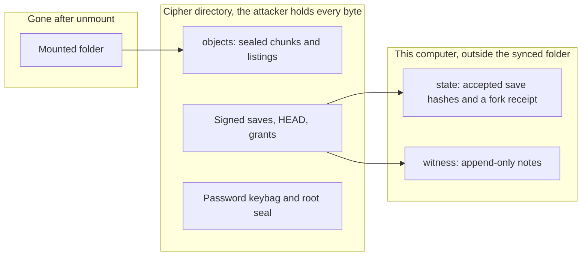
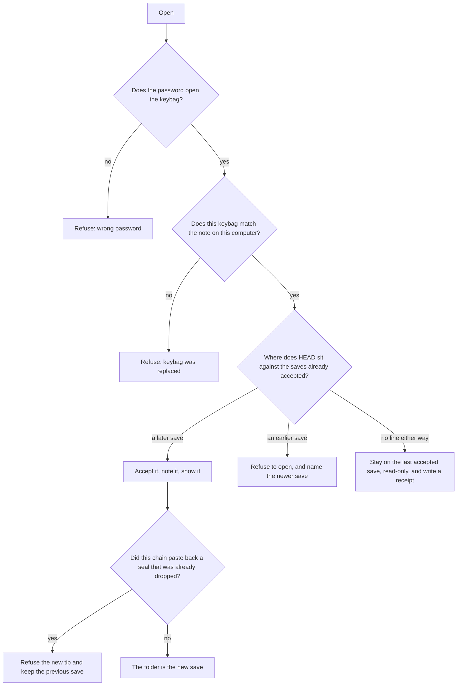
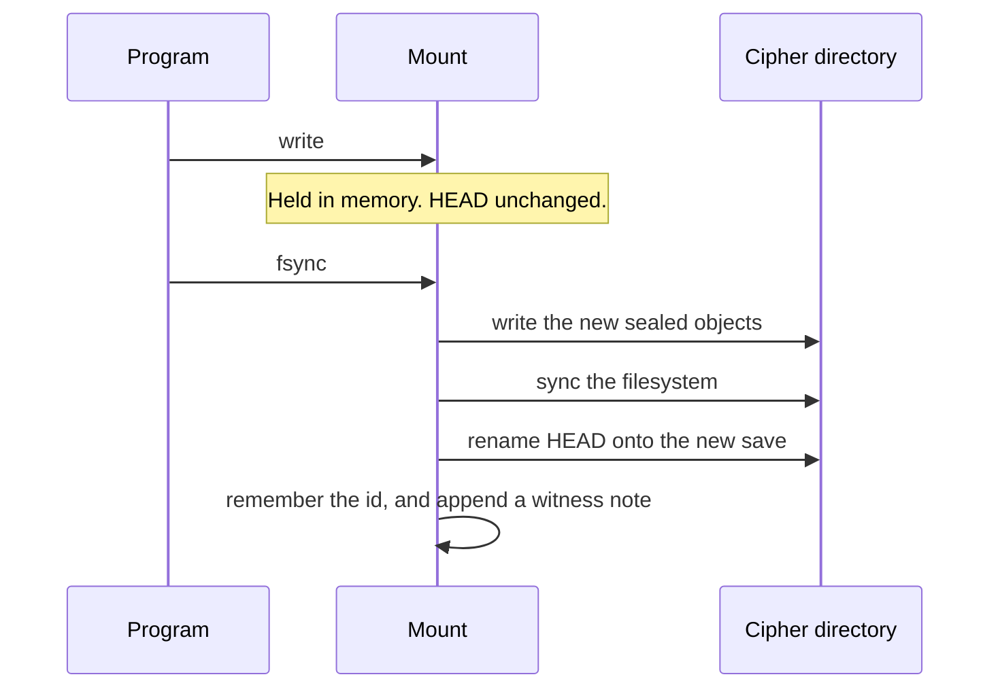
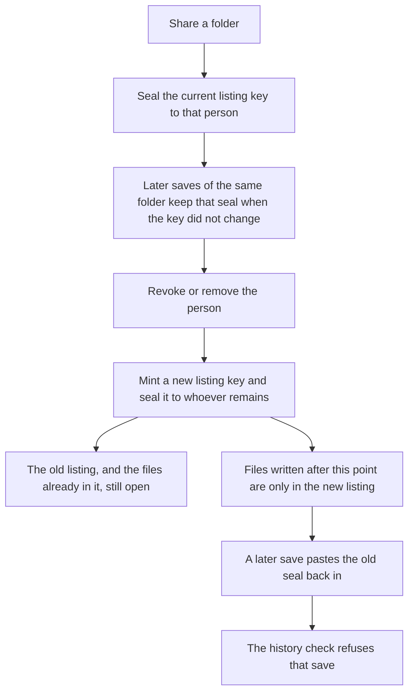

# How Pebble works

This is the map of the running system: what a person does, what gets written, and why an old or edited copy does not pass as the current folder. The commands are in the [README](../README.md). The line-by-line match to the problem is in [requirements.md](requirements.md).

## The four places

A volume is not one directory. The synced folder is the only part the storage provider holds. The memory of what this computer has accepted, and the notes of what it has seen, stay beside that folder. The mounted folder is a view in memory and disappears on unmount.

`cipher/objects` is content-addressed. The name of an object is the SHA-256 of its bytes. `cipher/HEAD` is one line, the id of the current save. `cipher/keybag` is the owner's device keys, wrapped by the password. `cipher/root.seal` is the root listing key, sealed to the owner's exchange key. `state/accepted` is the list of save ids this computer has agreed to move forward to. `witness/log` is a note per save, signed by the device that saw it. `witness/keybag` is the same kind of note for the keybag file itself.

Copying the cipher directory copies none of `state` or `witness`. That is the whole reason a restored snapshot can be noticed. The provider can put last Tuesday's folder back. They cannot edit the note on the laptop that says a Wednesday save was already seen.

## What is stored

A file is cut into 64 KiB pieces. Each piece is sealed with XChaCha20-Poly1305 under that file's own key. The tag covers the chunk index, so a piece cannot be moved to a different position and still open. A directory listing is sealed under that directory's key. After the tag checks, the listing yields child names and child keys. The root listing key is the one inside `root.seal`. Every other key lives inside its parent listing, which is why someone without the parent key cannot walk the tree by reading the objects.

A save is a commit stored in the clear and signed with Ed25519. The signed bytes are the parent ids, the root listing id, and the author public key. When a folder has been shared, the commit also carries a grant per recipient: the folder path, the listing id, and the listing key sealed to that recipient's exchange key. The signature is checked before any parent id is followed. A bad signature never becomes a point in the history.

The password does not encrypt files directly. Argon2id stretches it, and that result wraps an Ed25519 seed and an X25519 seed inside the keybag. Opening the keybag is what lets the computer unseal `root.seal` and sign the next save. The password buffer is wiped when that returns, including when the password is wrong.

## Opening the folder

`status` and `mount` do the same check. A mount then serves the tree the check allowed.

The three history answers come from parent links only. A save is an update when the tip can be walked back to every save this computer has accepted and witnessed. It is a rewind when some accepted or witnessed save can be walked forward to the tip, which means the tip is older. It is a split when neither walk works: two histories share an ancestor and then diverge. The computer does not pick a winner. It keeps showing the last save it had accepted, and it writes `state/receipt`.

The receipt holds the two signed commits. `verify-proof` checks both signatures and prints the two ids. It does not need the password, and it cannot read the files. It shows that the histories diverged. It does not say which person was dishonest, because a real offline edit on two machines looks the same as a provider handing each machine a different history.

The witness log is what catches a provider who deletes the newer save instead of merely pointing `HEAD` at an older one. The accepted list on this computer already remembers the newer id. The log remembers it too, and the log is append-only: a torn tail from a crash is ignored, and a complete record with a bad signature is refused. The next open still has the newer id in hand, so the older `HEAD` is a rewind rather than the only history anyone can see.

Grant history is a second check on the way to an update. The checker walks the chain and remembers listing ids and seals it has already seen move on. A listing id for a path may stay or move forward. It may not return after a newer id was published. A seal that disappeared may not reappear. That is why restoring the old share list fails even when the new commit is signed and its parent pointer is honest.

## Publishing a save

`put` writes the new encrypted objects and a `STAGED` line. `HEAD` stays where it was, so a crash during the copy leaves the previous save as the folder. `commit` signs the staged listing, syncs the object store once, and renames `HEAD` onto the new id. The rename is the moment the save becomes current.

On a read-write mount the same order runs inside fsync, and at the end of rename, unlink, rmdir, and mkdir. Bytes sitting in a file that was never fsynced are not a save. Killing the writer during `write` leaves the previous `HEAD`. FUSE itself refuses a second mount on a mountpoint that is already in use. Two `pebble mount` processes on the same volume are not separately locked by Pebble.

One mount runs at a time, locked from the state directory, so two writers on this computer do not publish over each other.

## Sharing a folder, and taking it back

The owner can read every listing because they can open the root. A member cannot. Their mount walks the commits from the tip backward and keeps, for each path, the newest grant their key can still open. The mounted tree is only those folders, grafted onto an empty root. A neighboring folder was never sealed to them, so it is not in that tree. The ciphertext of that neighbor does not help: the key that would open it is inside a listing they cannot decrypt.

`add-user` creates `home/<name>` and seals it to that member. That home is their folder. `share` seals some other folder the same way. The files in the folder are shared because their keys sit in that listing. Sharing one file and not its sibling is done by putting the file in its own folder and sharing that folder.

`revoke` replaces the listing key for that one folder and seals the new key only to the people who remain. The file keys inside the old listing are left alone, and the chunks are not rewritten. A member who already opened the old listing can still read those files. A file added afterwards is named only in the new listing, which their old seal does not open. `remove-user` rotates every folder that was sealed to that person, including their home, and deletes their public key and their keybag copy from the cipher directory.

Lazy revocation is the reason the volume is not re-encrypted. The confidentiality of new writes comes from the new listing key. The confidentiality of old writes was already lost to anyone who had the old key, and re-encrypting the chunks would not take those bytes back from a provider who kept the old objects.

## Password change

`passwd` on the volume unwraps the keybag, wraps the same two seeds with the new password, and writes the file back. The public keys do not change, so existing seals and old commit signatures stay valid. Before the new file is written, its hash is stored in `state/keybag-next`. After the write, a witness note records that hash and the pending file is removed.

If the computer stops between the write and the note, the next open with the new password sees a keybag whose hash matches the pending file, appends the note, and continues. The old password does not open the new file, so that crash does not leave the volume on the old password.

If the old keybag file is copied back over the new one, the old password can unwrap it, and the hash does not match the note. The open stops with `keybag was replaced`. The new password does not unwrap the old file, and that refusal is `wrong password`.

This binds the current keybag to this computer. It does not rotate directory keys. A copy of the old keybag, on a computer that never wrote the new note, still unwraps with the old password and still opens the same seals.

A member changes the keybag file they hold with `passwd --keybag`. That rewraps the file and does not write a witness note. The file they mount with should be the one they changed. An old copy of that file still unwraps with their old password.

## What the attacker can do with the bytes

They can read every object. They see ciphertext, commit structure, and public keys. They do not see file contents, listing names, or the password.

They can flip, truncate, or replace an object. The tag or the signature fails, and the computer does not parse the plaintext of a failed object. Oversized objects are refused from the length before the parse.

They can point `HEAD` at an older save, or replace the whole directory with an older snapshot. A computer that has seen the newer save refuses to open.

They can keep two children of the same parent and show a different one to each person. Each computer reports a split and writes a receipt. The two receipts name the same divergence. Neither computer silently fast-forwards onto the other history.

They can delete a member's revocation by replaying an old grant list inside a new signed commit. The history check refuses the update. They can delete the member's files from the cipher directory; the member's access was the seal, not the presence of the copy.

They cannot edit `state` or `witness` on a computer they do not run. The problem gives them the stored copy, not the running system.
